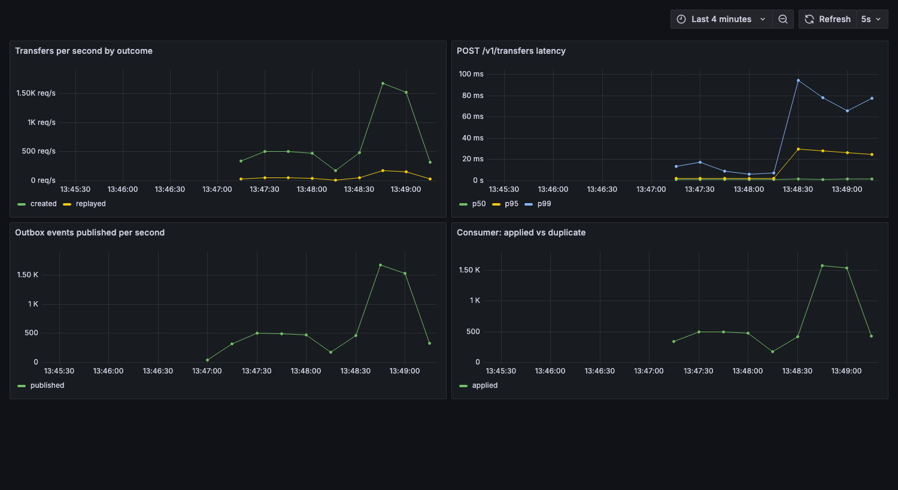

# Ledger

[](https://github.com/kumarrohitkumar/ledger/actions/workflows/ci.yml)

**A double-entry payments ledger where a retried request, a crashed worker or a duplicated Kafka message can never move money twice.**

Go · PostgreSQL · Kafka (Redpanda) · Prometheus · Grafana · Docker · k6

## At a glance

- **Exactly-once money movement:** every transfer needs an `Idempotency-Key`. A retry, or 20 identical requests fired at the same moment, produce exactly one transfer; the key and the transfer commit in one transaction.
- **Double entry, provably balanced:** each transfer writes a debit and a credit that sum to zero; balances are cached for speed and a reconciliation job proves they still match the postings.
- **No lost or doubled events:** a transactional outbox publishes to Kafka at-least-once, and the consumer stores each event's effect and its id in one transaction, so redelivery changes nothing.
- **Tested where it breaks:** crash tests kill the relay after publishing and the consumer before committing offsets, on real Postgres and Redpanda containers; 200 concurrent transfers conserve every paisa.
- **Measured:** 30,001 transfers in 60 s at 500 req/s with p95 2.1 ms and 0 errors; about 1,800 transfers/s at the limit of a laptop, and the ledger reconciles cleanly after both runs.



## How it fits together

```
POST /v1/transfers  (Idempotency-Key)
   │
   ▼  one PostgreSQL transaction
   ├─ idempotency_keys   insert the key first; a duplicate waits on it, then replays
   ├─ accounts           SELECT … FOR UPDATE in id order (no deadlocks), no overdraft
   ├─ transfers + 2 postings    debit −X, credit +X, always summing to 0
   └─ outbox             the event commits with the money, or neither does
            │
   relay  (FOR UPDATE SKIP LOCKED, marks published after Kafka acks)  ──►  Kafka: ledger.transfers
            │                                                               (keyed by transfer id)
   consumer  (effect + processed_events in one transaction, then commit offsets)
            │
   statement_lines  (read model)        reconcile  (checks every invariant from the database alone)
```

| Guarantee | How it is enforced | Where |
|---|---|---|
| A request is applied once | Key row inserted in the same transaction; concurrent duplicates block on the unique index and replay the stored outcome; a reused key with a different body is refused | [`internal/ledger/service.go`](internal/ledger/service.go) |
| A refusal is stable | Insufficient funds, unknown account and currency mismatch are recorded inside a savepoint, so a retry gets the same answer | same |
| Money is conserved | Two postings per transfer summing to 0; `CHECK` constraints for positive amounts and no overdraft | [`migrations/001_init.sql`](migrations/001_init.sql) |
| No deadlocks | Both accounts locked in id order; deadlock and serialization errors retried | `move()` |
| Events are never lost | Outbox row written in the same transaction as the transfer | `move()` |
| Events apply once | `processed_events` row and the effect commit together; offsets committed afterwards | [`internal/consumer`](internal/consumer/consumer.go) |
| Drift is detectable | Reconcile: sum of postings = 0, every transfer balanced, cached balance = sum of postings, every transfer has an event, pipeline lag | [`internal/ledger/reconcile.go`](internal/ledger/reconcile.go) |

## Tests

```bash
go test ./...        # needs Docker: tests start real Postgres and Redpanda containers
go test -race ./internal/ledger/
```

| Test | What it proves |
|---|---|
| `TestConcurrentTransfersConserveMoneyAndNeverOverdraw` | 200 transfers, 50 at a time, between 5 accounts: no account goes negative, the total never changes, reconcile is clean. With the row locks removed, this test fails with deadlocks |
| `TestTheSameKeyFiredConcurrentlyCreatesExactlyOneTransfer` | 20 simultaneous requests with one key: one transfer, charged once |
| `TestInsufficientFundsIsRejectedAndRememberedUnderTheKey` | A refused request stays refused on retry, even after the account is topped up |
| `TestRelayCrashAfterPublishingIsHarmless` | The relay dies after Kafka acks but before marking; all 30 events are published twice and applied once |
| `TestConsumerCrashBeforeCommittingOffsetsIsHarmless` | The consumer dies after storing effects but before committing offsets; a replacement gets the records again and changes nothing |
| `TestTwoRelaysSideBySideDoNotDoubleSend` | Two relays draining 400 events mark exactly 400 between them |

18 tests across the ledger, the HTTP API and the Kafka pipeline.

## Load test

[`loadtest/transfers.js`](loadtest/transfers.js) funds 200 accounts, then sends transfers in random directions at a constant arrival rate, retrying 10% of requests with the same key as a client would after a timeout. When it finishes it waits for the pipeline to drain and checks reconciliation.

Measured on an Apple M2 laptop, everything (API, Postgres, Redpanda, k6) in Docker Desktop with 8 CPUs and 4 GB:

| Target | Transfers | p50 | p95 | p99 | Errors | Retries replayed | Reconcile |
|---|---|---|---|---|---|---|---|
| 500 req/s, 60 s | 30,001 (486/s) | 0.84 ms | 2.1 ms | 9.6 ms | 0 of 33,325 | 2,921 of 2,921 | clean, lag 0 |
| 2,000 req/s, 30 s | 59,720 (1,800/s) | 1.1 ms | 26 ms | 61 ms | 0 of 66,220 | 6,097 of 6,097 | clean, lag 0 |

At 2,000 req/s k6 dropped 0.5% of iterations: the laptop, not the service, was the limit. Raw output is in [`loadtest/results`](loadtest/results).

```bash
docker compose up -d --build
docker run --rm --network ledger_default -v "$PWD/loadtest:/scripts" \
  -e BASE_URL=http://ledger:8080 -e RATE=500 grafana/k6 run /scripts/transfers.js
```

## Run it

```bash
docker compose up --build
```

| | |
|---|---|
| API | http://localhost:8080 |
| Grafana dashboard "Ledger" | http://localhost:3001 (no login) |
| Prometheus | http://localhost:9090 |

```bash
BANK=$(curl -s localhost:8080/v1/accounts -d '{"name":"bank","currency":"INR","allow_negative":true}' | jq -r .id)
ASHA=$(curl -s localhost:8080/v1/accounts -d '{"name":"asha","currency":"INR"}' | jq -r .id)

# Send the same request twice: the second answer is a replay, not a second payment.
curl -si localhost:8080/v1/transfers -H 'Idempotency-Key: pay-001' \
  -d "{\"from\":\"$BANK\",\"to\":\"$ASHA\",\"amount\":150000}"          # 201 Created
curl -si localhost:8080/v1/transfers -H 'Idempotency-Key: pay-001' \
  -d "{\"from\":\"$BANK\",\"to\":\"$ASHA\",\"amount\":150000}"          # 200 OK, Idempotent-Replayed: true

curl -s localhost:8080/v1/accounts/$ASHA | jq .balance                   # 150000 (paise)
curl -s localhost:8080/v1/reconcile | jq                                 # {"ok": true, ...}
```

### API

| Method | Path | Notes |
|---|---|---|
| POST | `/v1/accounts` | `{name, currency, allow_negative}`; only internal accounts may go negative |
| GET | `/v1/accounts/{id}` | Balance in minor units |
| GET | `/v1/accounts/{id}/entries` | Postings, newest first |
| POST | `/v1/transfers` | `Idempotency-Key` header required. 201 new, 200 replay, 422 refused or key reused, 404 unknown account |
| GET | `/v1/transfers/{id}` | |
| GET | `/v1/reconcile` | Invariant report and pipeline lag |
| GET | `/metrics` | Prometheus |

`ROLE=api|relay|consumer|all` runs the parts separately or together; `DATABASE_URL`, `KAFKA_BROKERS` and `ADDR` configure them.

## Decisions and trade-offs

- **Money is `BIGINT` minor units.** No floats anywhere; a transfer of ₹1,500 is `150000`.
- **Cached balances plus append-only postings.** Reads are one row; reconciliation keeps the cache honest instead of trusting it.
- **Idempotency in the database, not in a cache.** The key commits atomically with the money, so there is no window where a crash leaves a key without its transfer or a transfer without its key.
- **Outbox instead of publishing from the request.** Writing to Kafka inside the request would either lose events (Kafka down after commit) or send events for rolled-back transfers.
- **At-least-once delivery, exactly-once effect.** Exactly-once delivery across a database and a broker is not something to rely on; deduplicating by event id at the consumer is simple and testable.
- **Not built (yet):** authentication, multi-currency FX, holds and two-phase transfers, partition-aware consumer scaling.
